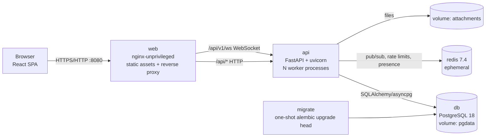
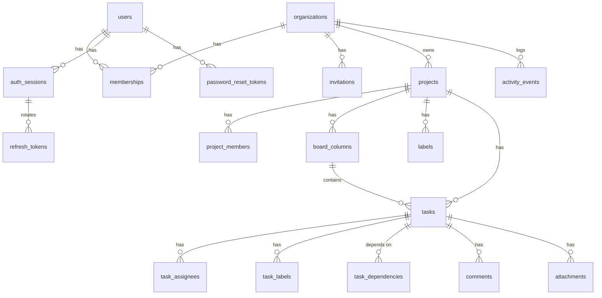

# TaskBoard — Architecture

## 1. Overview

TaskBoard is a multi-tenant project-management platform: organizations → projects → Kanban
boards → tasks, with dependencies, comments, attachments, activity history, dashboards and
real-time collaboration.



| Service | Image | Role | Exposed |
|---|---|---|---|
| `web` | multi-stage: Node 24 build → `nginx-unprivileged:1.28.2-alpine` | Serves the compiled SPA, SPA fallback for deep links, reverse-proxies `/api/` and `/api/v1/ws`, security headers, gzip, per-IP rate limits | host `${APP_PORT:-8080}` |
| `api` | multi-stage: `uv` locked deps → `python:3.13.18-slim`, uid 10001 | REST API + WebSocket hub | internal only |
| `migrate` | same image as `api` | `alembic upgrade head`, exits 0; `api` waits for `service_completed_successfully` | — |
| `db` | `postgres:18.6-alpine` | System of record | internal only |
| `redis` | `redis:7.4.12-alpine` | Realtime fan-out between API workers, presence, rate-limit counters (no persistence needed) | internal only |

Startup order (enforced by `depends_on` conditions): `db` healthy → `migrate` completes → `redis`
healthy → `api` healthy (`/api/health/ready` checks DB, Redis and schema version) → `web` starts.

## 2. Code layout

```
backend/taskboard/
  config.py          env-only settings; refuses placeholder secrets in production
  db.py              async engine/session; naming convention for constraints
  models/            SQLAlchemy 2 ORM models (one module per aggregate)
  schemas/           Pydantic request/response models + input sanitation
  security/          argon2id passwords, JWT/opaque tokens, CSRF, Redis rate limiting
  authz.py           THE authorization layer (all resource loaders)
  services/          business logic, one module per area; owns transactions
  domain/            pure algorithms: dag.py (dependency graph), positions.py
  realtime/          bus.py (Redis pub/sub), hub.py (connections, presence), ws.py (protocol)
  api/v1/            thin FastAPI routers
  cli.py             seed-load (load-test fixture), cleanup-orphans
  main.py, serve.py  app factory, middleware, error handlers; production entrypoint
backend/alembic/     migrations (advisory-locked env.py)
backend/tests/       unit/ (pure) and integration/ (real PostgreSQL + Redis + live uvicorn)
frontend/src/
  lib/               api client, auth, realtime client, query hooks, pure board logic
  components/        ui kit (accessible fields, dialogs, toasts) and app shell
  pages/             auth, org, project (board, list, dependencies, activity, settings), dashboard
tests/e2e/           Playwright suite (runs in a container on the compose network)
tests/load/          k6 scenario; tests/deploy/ deployment-check helpers
scripts/             generate-secrets, test-*, deploy-check, load-test, run-all-tests
```

Layering rule: routers parse/serialize only; services do all writes inside one transaction
and call `authz` first; `domain/` has no I/O and is unit-tested exhaustively.

## 3. Data model



Key points
- UUID primary keys (non-enumerable); `activity_events.id` is a `bigint identity` and doubles
  as the realtime replay cursor.
- `users.email` is `CITEXT` (case-insensitive unique). Enumerations are `VARCHAR + CHECK`
  (cheap to evolve, no PostgreSQL enum migrations).
- `tasks.version` implements optimistic concurrency; `tasks.number` is a per-project sequence
  allocated by `UPDATE projects SET task_seq = task_seq + 1 … RETURNING` (row lock ⇒ unique).
- `tasks.search_vector` is a generated `tsvector` (title weight A, description B) with a GIN
  index; `pg_trgm` GIN index on title supports substring search.
- Indexes for every access path: `(column_id, position)`, `(project_id, updated_at, id)`,
  `(project_id, created_at, id)`, partial `(project_id, due_date) WHERE completed_at IS NULL`,
  `(project_id, completed_at)`, `task_assignees(user_id)`, `task_dependencies(depends_on_id)`,
  `activity_events(project_id, id)`, `(org_id, id)`, `(task_id, id)`, `memberships(user_id)`.
- `task_dependencies` has `CHECK (task_id <> depends_on_id)`; same-project is enforced in
  the service; acyclicity is enforced by the dependency engine (§7).

## 4. Authentication

- **Passwords**: Argon2id (`argon2-cffi`, t=3, m=64 MiB, p=2 by default; configurable), automatic
  rehash on login when parameters change. Policy: 10–128 chars, three of four character
  classes (mirrored client-side for UX, enforced server-side).
- **Access tokens**: HS256 JWT, 15 min, claims `sub`, `sid` (session id), `iss`, `aud`, `typ`,
  `jti`; algorithm pinned on decode (rejects `alg=none` / foreign keys). Held **in memory** in the
  browser (never in localStorage) and sent as `Authorization: Bearer`.
- **Sessions / refresh tokens**: a login creates an `auth_sessions` row (a rotation family) and an
  opaque 256-bit refresh token stored only as SHA-256. The token is an `HttpOnly; SameSite=Strict;
  Path=/api/v1/auth` cookie (`Secure` when `COOKIE_SECURE=true`). Every refresh marks the token
  used and issues a new one. **Replay of a used token revokes the whole session** (theft
  assumption). Each authenticated request checks the session is not revoked (one PK lookup), so
  logout, "sign out everywhere", password change/reset and session revocation take effect
  immediately — including open WebSockets (closed with 4401).
- **Cross-tab refresh**: the client single-flights refreshes and serializes them across tabs
  with the Web Locks API, so concurrent tabs never trip replay detection.
- **CSRF**: only `/auth/refresh` and `/auth/logout` read cookies. They require (a) SameSite=Strict
  cookie, (b) an allowed `Origin`/`Referer` when present, and (c) a double-submit token
  (`tb_csrf` cookie must equal `X-CSRF-Token` header). All other endpoints are Bearer-only and
  therefore not CSRF-able.
- **Brute force**: Redis counters — per-IP request budget on auth endpoints; per (email, IP)
  lockout after `LOGIN_MAX_FAILURES` in the window; per-account lockout at 4× that threshold
  (slows distributed guessing while limiting victim lock-out). During lockout even the correct
  password is refused (429 + `Retry-After`). nginx `limit_req` is an outer layer.
- **Error hygiene**: identical 401 body for unknown user vs wrong password; a dummy Argon2
  verification equalizes timing; password-reset requests always return 202.
- **Password reset**: single-use, 1-hour token (hashed), previous tokens invalidated on new
  request; success revokes all sessions. Delivered by SMTP (or written to the log with
  `EMAIL_BACKEND=console`).
- **Invitations**: hashed single-use tokens bound to the invitee email (case-insensitive); the
  admin also receives the link in the UI so the flow works without SMTP.

## 5. Authorization (RBAC + tenant isolation)

All checks live in `taskboard/authz.py`; services call a loader before touching data.

| Capability | Owner | Admin | Member | Viewer |
|---|:-:|:-:|:-:|:-:|
| See all org projects | ✓ | ✓ | assigned only | assigned only |
| Read board/tasks/comments/attachments (visible projects) | ✓ | ✓ | ✓ | ✓ |
| Create projects | ✓ | ✓ | ✓ (becomes member) | — |
| Create/edit/move/delete tasks, comment, upload, labels, dependencies | ✓ | ✓ | ✓ | — |
| Project settings (rename, columns, members, archive, delete) | ✓ | ✓ | — | — |
| Invite / change roles / remove members | ✓ | ✓ (not owners) | — | — |
| Invite or promote owners, demote/remove owners | ✓ | — | — | — |
| Delete organization | ✓ | — | — | — |

- A resource the caller cannot see returns **404 with a generic message** (existence is never
  revealed); visible-but-forbidden returns 403.
- Every query is scoped through joins to the caller's memberships; ids from another tenant
  (columns, labels, assignees, dependency targets, dashboard `project_id`) are rejected.
- At least one owner must always remain. Archived projects are read-only for everyone.
- **Workflow rule:** new tasks are always created in the project's first (leftmost, "intake")
  column and then pulled across the board. The API rejects a `column_id` for any other column
  (422); the UI only offers "Add task" on the first column. The intake is whichever column is
  first after renames/reorders, and its WIP limit applies to creation.
- WebSocket subscriptions use the same loader; access changes publish a control message that
  makes every API worker re-authorize that user's live subscriptions.

## 6. Concurrency and transactional integrity

- **Optimistic concurrency** on tasks (and projects): clients send `version`; the service
  checks it and then executes `UPDATE … WHERE id = :id AND version = :v`. Under READ COMMITTED
  a concurrent writer blocks on the row lock and then re-evaluates the predicate, so exactly one
  writer wins; losers get **409 `version_conflict` with the current server copy**, and nothing of
  theirs is written. The UI shows a conflict banner offering "use latest" or "overwrite".
- **Atomic multi-record operations**: each service method is a single transaction (task update
  + assignee/label changes + activity row; column delete + task moves; member removal + project
  memberships + assignments; project/org delete). Any exception rolls back everything.
- **Transactional outbox for realtime**: activity rows are written in the same transaction;
  realtime messages and file deletions are queued on the session and executed **only after a
  successful commit** — clients never see rolled-back changes; files are never deleted for a
  failed delete.
- **Retention policy**
  - *Delete project*: hard delete via `ON DELETE CASCADE` (tasks, columns, labels, dependencies,
    comments, attachment rows, the project's activity). An org-level `project.deleted` audit event
    with a name/count snapshot is retained. Attachment files are unlinked after commit.
  - *Delete task*: cascades its dependency edges (both directions), comments, attachments; its
    history is **kept** (`task_id` set NULL, payload holds a snapshot) so project timelines stay
    truthful.
  - *Delete column*: requires a target column; tasks are moved atomically.
  - *Remove member*: project memberships and task assignments in that org are removed atomically.
  - *Delete organization* (owner only): cascades everything.
  - An orphan sweeper (startup + `cli cleanup-orphans`) removes attachment files without rows
    older than one hour (crash between commit and unlink). It checks candidates against the
    database in batches of 500 (bounded memory) and runs in one worker only (advisory try-lock).

## 7. Task dependency engine

`domain/dag.py` (pure, O(V+E)):
- `cycle_if_added(edges, task, depends_on)` — BFS from `depends_on` looking for `task`; returns
  the cycle path for a readable error (e.g. `WEB-1 → WEB-4 → WEB-3 → WEB-2 → WEB-1`).
- `topological_order` — Kahn's algorithm with a heap for deterministic tie-breaking (higher
  priority first, then lower task number).
- `blocked_and_ready` — blocked = open with any open dependency; ready = open with all
  dependencies done. "Done" = the task is in a column flagged `is_done`.

Race safety: mutations take a per-project `pg_advisory_xact_lock` before reading the edge set,
so two concurrent requests (A→B and B→A) cannot both pass the check (covered by a test that
forces the interleaving). Measured: 3,000 tasks / ~6,000 edges → graph endpoint 28 ms, cycle
check 17 ms; 10,000 nodes / 30,000 edges in-memory < 2 s budget (unit test).

## 8. Real-time protocol

Endpoint `/api/v1/ws` (through nginx). Origin must be allowed (cross-site WebSocket hijacking
protection). The token is sent in the **first message** (never in the URL/logs); 5 s timeout.

Client → server: `auth`, `subscribe {project_id, since?}`, `unsubscribe`, `subscribe_org`,
`presence {project_id, viewing_task_id}`, `ping`, `reauth {token}`.
Server → client: `ready`, `event {id, type, payload(snapshot), actor…}`, `subscribed
{replayed, presence}`, `presence {users}`, `resync_required`, `unsubscribed {reason}`,
`project_deleted`, `error`, `pong`. Close codes: 4401 auth/session, 4403 origin, 4408 auth
timeout, 1012 server restart, 1013 slow consumer.

- **Fan-out**: after commit, events are published to Redis channel `tb:project:<id>`; every API
  worker holds one pattern subscription and forwards the *already-serialized* string to its
  local subscribers (no per-recipient serialization). Each connection has a bounded queue and
  its own writer task; a slow consumer is disconnected instead of stalling others.
- **Recovery**: the client tracks the last event id per project; on reconnect it resubscribes
  with `since` and the server replays `activity_events` newer than that (≤ `WS_REPLAY_LIMIT`,
  otherwise `resync_required` → full board refetch). Clients de-duplicate by event id and only
  apply task snapshots with a higher `version`, so replay/live overlap is harmless.
- **Reconnection**: exponential backoff with jitter (0.5 s → 30 s), immediate retry on the
  browser `online` event, heartbeat every 20 s, token renewal via `reauth`.
- **Presence**: Redis hash per project (`connection → user, viewing task, timestamp`) with TTL
  and staleness filtering; join/leave/viewing changes broadcast to the project.

## 9. Attachments

Stored on the `attachments` named volume under random hex keys (sharded by prefix), never
user-controlled paths. Upload is streamed with a hard size cap (`MAX_UPLOAD_MB`, also enforced
by nginx), SHA-256 computed; content type is detected from magic bytes and must match an
allow-list (images, PDF, ZIP/Office, UTF-8 text formats). SVG/HTML/executables, mismatched
extensions and text files containing markup are rejected (415). Downloads go through the
authorized API with `Content-Disposition: attachment`, `X-Content-Type-Options: nosniff`,
`Content-Security-Policy: default-src 'none'; sandbox`.

## 10. Security controls summary

| Threat | Control |
|---|---|
| SQL injection | SQLAlchemy bound parameters only; LIKE metacharacters escaped; tests send injection strings |
| XSS | React escaping, no `dangerouslySetInnerHTML`; strict CSP (`script-src 'self'`, no inline scripts); input control-character stripping; active-content uploads rejected |
| Broken object-level auth / cross-org leakage | central `authz` loaders, joins scoped by membership, 404 on invisible resources; parametrized isolation tests over every endpoint |
| Brute force | Redis per-IP / per-account lockouts, nginx `limit_req` |
| Token replay | refresh rotation with reuse detection (family revocation); short-lived access tokens; server-side session check |
| CSRF | Bearer-only API; cookie endpoints need SameSite=Strict + Origin check + double-submit token |
| Unauthorized WebSocket subscriptions | Origin check, first-message auth, per-subscription authorization, live revocation |
| Insecure uploads | size cap, magic-byte allow-list, random storage keys, sandboxed downloads |
| Secrets | env vars only; production refuses placeholder/short secrets; `generate-secrets.sh` |
| Container hardening | non-root (uid 10001 / nginx 101 / redis 999), read-only root FS + tmpfs, `cap_drop: ALL`, `no-new-privileges`, DB/Redis/API not published |
| Clickjacking / sniffing | `X-Frame-Options: DENY`, `frame-ancestors 'none'`, `nosniff`, Referrer-Policy |
| Client IP spoofing | nginx overwrites `X-Forwarded-For` with `$remote_addr`; only `TRUSTED_PROXY_CIDRS` are honoured by the realip module; the API trusts forwarded headers only from Docker private ranges (`API_TRUSTED_FORWARDERS`; loopback/public never; outside compose: nobody), verified by a forged-header lockout check |
| Oversized requests | nginx `client_max_body_size` plus an ASGI middleware in the API (JSON ≤ 1 MB, multipart ≤ upload limit + 1 MB, chunked bodies counted) → 413 even without nginx |
| Transport | Session cookies are `Secure` automatically for an `https://` `PUBLIC_BASE_URL`; opt-in HSTS (`HSTS_ENABLED`) for HTTPS deployments |

## 11. Performance design

- Keyset (cursor) pagination on `(sort_key, id)` for every sort field; no OFFSET scans.
- Eager loading with `selectinload` (assignees, labels) — query count is constant regardless of
  page size (asserted by `test_listing_has_no_n_plus_one`).
- Aggregates (dashboard, project summaries) computed in single SQL statements with `FILTER`
  clauses and `generate_series` for zero-filled trends.
- Board payload uses a compact card schema (no descriptions).
- uvicorn with uvloop/httptools, multiple workers; Redis fan-out keeps workers stateless.
- Measured results are in `TEST_RESULTS.md` (100 concurrent users, 10,000 tasks).

## 12. Deployment design

- One command: `docker compose up -d --build`. Named volumes `pgdata` and `attachments` survive
  `down`/`up`/rebuilds. Redis holds only ephemeral data (rate limits, presence).
- Migrations: the `migrate` job runs before any API container; `alembic/env.py` additionally
  takes a transaction-scoped advisory lock, so any number of concurrent runners serialize
  (tested with 4 concurrent runners: exactly one applies, all exit 0). Re-runs are no-ops.
- Health checks on every service; restart policy `unless-stopped`; json-file log rotation
  (10 MB × 5); memory limits; structured JSON logs to stdout with request ids.
- Graceful shutdown: tini (`init: true`) forwards SIGTERM; uvicorn drains for up to 20 s; the
  lifespan closes WebSockets with 1012 (clients reconnect elsewhere), Redis and the DB pool.
- TLS: terminate at an external reverse proxy; set `COOKIE_SECURE=true`, `PUBLIC_BASE_URL=https://…`
  and `TRUSTED_PROXY_CIDRS` to the proxy's address so client IPs are preserved.
- Reproducible builds: pinned base image tags, `uv.lock` (with an `exclude-newer` cutoff),
  `package-lock.json` + `npm ci`; the app package is always reinstalled from source in the image
  (`--reinstall-package`), preventing stale cached wheels.

## 13. Decisions and trade-offs

| Decision | Why | Trade-off |
|---|---|---|
| Tasks are created only in the intake (first) column | Enforces planning: work enters the backlog and moves right as it is pulled | Already-started work must be added to the intake column and moved; bulk seeding (`cli seed-load`) bypasses the API by design |
| One board per project with fully customizable columns | Matches how teams use Kanban; keeps dependency/ordering semantics simple | Multiple boards per project not supported (use multiple projects) |
| Redis for fan-out/presence/rate limits | Standard, simple, supports N API workers/replicas | One more service (ephemeral, no backups needed) |
| Separate `migrate` job + advisory lock | No startup race, API never serves an old schema | Slightly longer cold start |
| Access token in memory + HttpOnly refresh cookie | XSS cannot exfiltrate the long-lived credential; survives reloads | Needs CSRF controls on two endpoints (implemented) |
| Session check per request | Immediate revocation | One indexed PK lookup per request |
| Float positions with midpoint insertion + rebalance | O(1) moves, rare rebalances | Rebalance touches a whole column (positions only, versions untouched) |
| Activity table doubles as replay log | One source of truth for history and recovery | Event payloads include task snapshots (larger rows) |
| `EMAIL_BACKEND=console` default | Works out of the box without SMTP | Reset/invite links appear in logs until SMTP is configured (warning logged at startup) |
| Hard delete with audit snapshot | Clear retention semantics, no zombie data | Deleted projects are not restorable (archive exists for reversible removal) |
